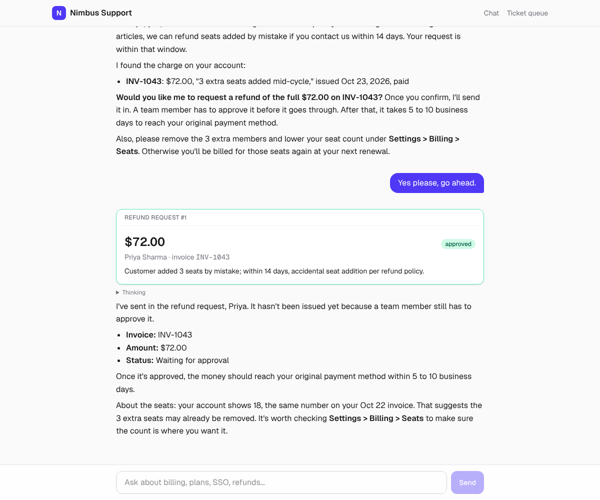
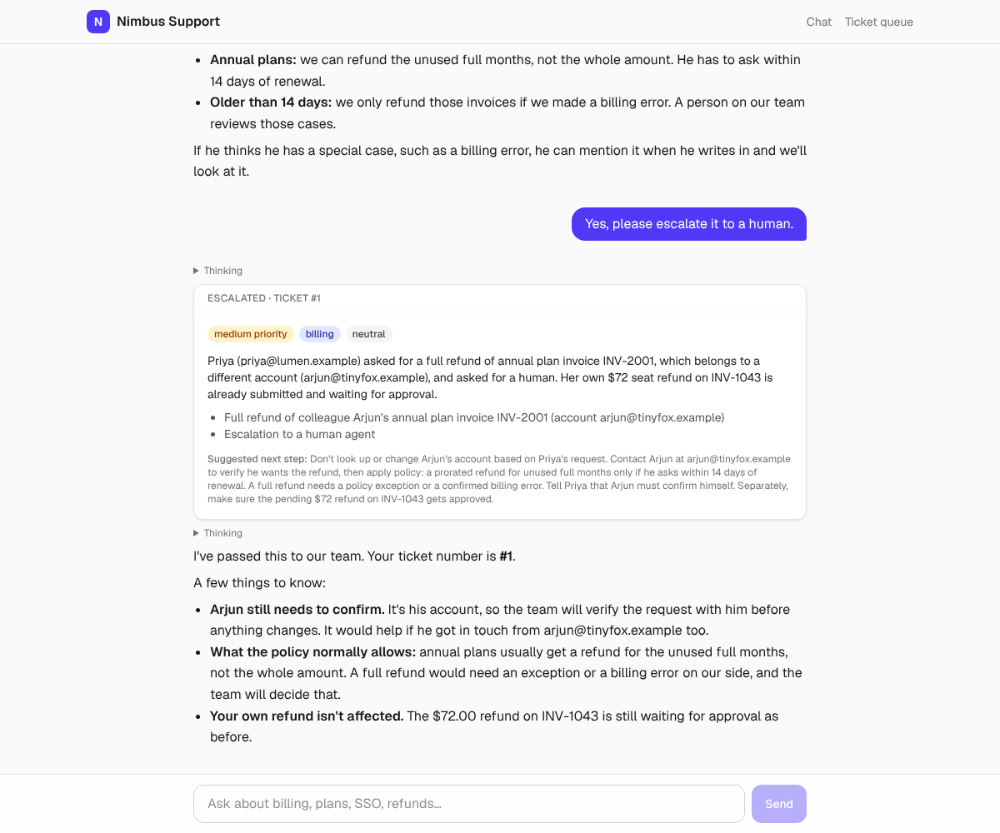

# Nimbus HelpDesk: an AI support agent

A full-stack AI support agent for **Nimbus**, a fictional project management SaaS. Customers chat with
"Nim", which answers from the help center, looks up their account and invoices, proposes refunds that a
human approves, and escalates to a human queue with a machine-triaged ticket.

**Live demo:** _add your Vercel URL here_

| Refund with human approval | Escalation with structured triage |
|---|---|
|  |  |

## What it shows

| Skill | Where |
|---|---|
| **Streaming** | Claude's token stream is translated, event by event, into the Vercel AI SDK UI message stream protocol by FastAPI ([`api/app/agent.py`](api/app/agent.py), [`api/app/streaming.py`](api/app/streaming.py)). No Node proxy in between. |
| **Tool calling** | A manual, streaming agent loop with 5 tools. Tool arguments stream into the UI as they are generated, and every input is validated with Pydantic before it runs ([`api/app/tools/base.py`](api/app/tools/base.py)). |
| **Structured outputs** | Escalations are triaged by Claude into a validated `TicketTriage` Pydantic model (category, priority, sentiment, asks), which powers the sortable ticket queue ([`api/app/helpdesk/triage.py`](api/app/helpdesk/triage.py)). |
| **RAG with pgvector** | Recursive chunking with overlap, OpenAI embeddings, and **hybrid retrieval**: HNSW cosine search and Postgres full-text search fused with Reciprocal Rank Fusion in one SQL query ([`api/app/rag/`](api/app/rag)). |
| **Retrieval evals** | 20 labelled questions measuring hit@1, hit@3 and MRR, plus a regression floor in CI ([`api/evals/`](api/evals)). |
| **Generative UI** | Each tool call renders as its own React component while it streams: customer card, invoice table, refund approval card, ticket card, collapsible sources ([`web/src/components/ToolPart.tsx`](web/src/components/ToolPart.tsx)). Tool input and output types are shared through a typed `UIMessage`. |
| **Guardrails and human in the loop** | Refund policy is enforced in code, not only in the prompt: 14-day window, paid invoices only, no over-refunding (pending refunds count), $500 agent limit. The model can only create a *pending* refund; a person approves it in the UI ([`api/app/helpdesk/repo.py`](api/app/helpdesk/repo.py)). |
| **Production basics** | Async FastAPI + psycopg pool, per-IP rate limiting to cap API spend, typed settings, Docker image, CI with a real pgvector service, 27 pytest tests. |

## Architecture

Full folder-by-folder guide and request flow: [docs/ARCHITECTURE.md](docs/ARCHITECTURE.md).

```
Next.js 16 (Vercel)                         FastAPI (Render)                      Postgres + pgvector (Neon)
┌────────────────────────┐  POST /api/chat  ┌──────────────────────────────┐      ┌───────────────────────┐
│ useChat (AI SDK 7)     │ ───────────────▶ │ agent loop                   │ ───▶ │ documents / chunks     │
│  text, reasoning,      │ ◀─────────────── │  Claude messages.stream()    │      │  HNSW + GIN indexes    │
│  tool-* parts ─▶ cards │   SSE, UI msg    │  ─▶ tools ─▶ AI SDK parts    │      │ customers / invoices   │
│ Refund approve/deny ───┼──────────────────▶ /api/refunds/{id}/decision  │      │ refunds / tickets      │
│ /tickets queue         │ ◀── /api/tickets │ triage: messages.parse()     │      └───────────────────────┘
└────────────────────────┘                  └──────────────────────────────┘
```

## Run it locally

Prerequisites: Docker, [uv](https://docs.astral.sh/uv/), Node 22, an Anthropic API key and an OpenAI API key (embeddings).

```bash
docker compose up -d                      # Postgres 16 + pgvector on :5432

cd api
cp .env.example .env                      # add your API keys
uv sync
uv run python -m app.helpdesk.seed        # demo customers, invoices, help-center articles
uv run uvicorn app.main:app --reload      # http://localhost:8000/docs

cd ../web
cp .env.example .env.local
npm install
npm run dev                               # http://localhost:3000
```

No API keys yet? Set `EMBEDDER=hash` to use the offline embedder; the chat still needs `ANTHROPIC_API_KEY`.

Tests and evals:

```bash
cd api
uv run pytest                             # needs Postgres; set TEST_DATABASE_URL if not on localhost:5433
uv run python -m evals.retrieval          # hit@1 / hit@3 / MRR against your configured embedder
```

## Deploy

1. **Database:** create a free [Neon](https://neon.tech) project and copy its connection string. pgvector is built in; the API creates the extension and tables on startup.
2. **API:** on [Render](https://render.com), create a Blueprint from this repo (`render.yaml`). Set `DATABASE_URL`, `ANTHROPIC_API_KEY`, `OPENAI_API_KEY`, and `CORS_ORIGINS` (e.g. `["https://your-app.vercel.app"]`). Seed once with `curl -X POST https://<api>/api/admin/reset -H "x-admin-token: <ADMIN_TOKEN>"`.
3. **Web:** import the repo on [Vercel](https://vercel.com) with root directory `web` and `NEXT_PUBLIC_API_URL=https://<api>.onrender.com`.

## Demo script (60 seconds)

1. "What's the difference between Pro and Business?": RAG answer with sources.
2. "I'm priya@lumen.example. We added 3 seats by mistake this week, can I get that refunded?": customer card, then a refund card you approve as the support lead.
3. "arjun@tinyfox.example here. I want a full refund of my annual plan.": the $600 refund is blocked by the $500 policy limit in code, and the agent offers to escalate.
4. "I lost my 2FA phone and I'm the workspace owner.": escalation with a triaged ticket; open **Ticket queue**.

## Design decisions

- **FastAPI speaks the AI SDK protocol directly.** The frontend keeps `useChat`'s streaming, tool parts and stop button without a Next.js route proxying tokens, and the Python side owns all model calls and secrets.
- **Hybrid retrieval over pure vectors.** Support questions mix intent ("money back") with exact terms ("audience mismatch", "SAML"). RRF fusion handles both with no extra service. Keyword terms are OR-ed, because AND-ing every word of a conversational question rarely matches.
- **Policy in code, approval by a person.** Prompts are guidance; the repository layer is the guardrail. The model's refund tool can't move money.
- **Manual tool loop instead of a framework.** About 100 lines, easy to read in an interview, and it maps Claude stream events 1:1 onto UI parts.

## Next steps

- LLM-as-judge answer evals and a prompt regression suite (Month 2)
- Conversation persistence and auth for the approver view
- Prompt caching for the system prompt and tool definitions
- OpenTelemetry traces for each tool call
